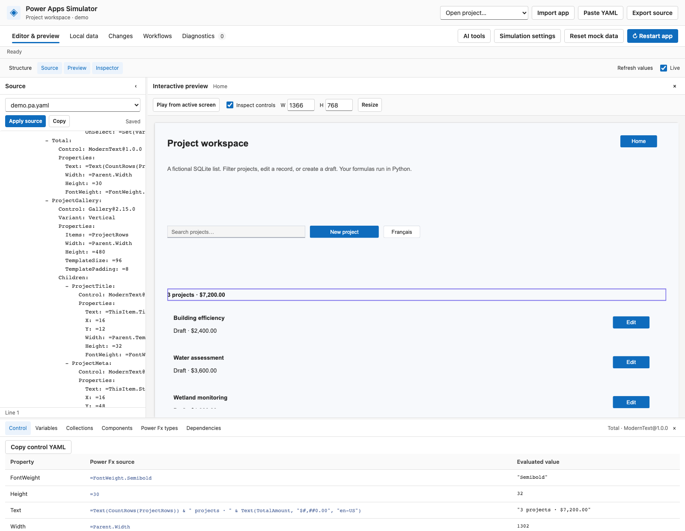

# Power Apps Simulator

An independent local simulator for Power Apps canvas apps. Edit Power Apps YAML and Power Fx alongside an interactive browser preview, with SharePoint-shaped mock data stored in SQLite.

Use it to explore app behaviour, inspect formulas and component state, and test changes against fictional data. Runtime assets are served locally; Python is the only required runtime.

This community project is not affiliated with or endorsed by Microsoft. Power Apps and Power Fx are Microsoft product names.



The bundled project-workspace example lets you filter projects, edit records, and create drafts using fictional data. Select a control with **Inspect controls** to see its Power Fx source and current value.

## Quick start

Python **3.11–3.14** is the supported target. From the project directory:

**macOS / Linux**

```sh
python3 -m venv .venv
.venv/bin/python -m pip install -r requirements.txt
.venv/bin/python -m powerapps_sim
```

**Windows**

```bat
py -3 -m venv .venv
.venv\Scripts\python.exe -m pip install -r requirements.txt
.venv\Scripts\python.exe -m powerapps_sim
```

The browser opens at **http://127.0.0.1:8765** with a fictional demo. After setup, `start.sh` and `start.cmd` are shortcuts. Stop the server with Ctrl+C.

Use **Import app** to open an `.msapp`, `.yaml`, or `.yml` file, or pass `--import /path/to/app.msapp` to the command above. Archives must contain `Src/` YAML. Use `--workspace` to choose storage, `--port` to change the port, and `--no-browser` to suppress automatic browser opening.

To install the package and its `powerapps-sim` command, run `python -m pip install .` using your virtual environment's Python. The Python module is `powerapps_sim`.

## What it does

- Preserves source YAML, comments, control versions, and formulas through local editing and export.
- Evaluates supported Power Fx expressions, components, events, forms, and local list operations.
- Provides runtime, type, dependency, diagnostic, and component inspectors.
- Simulates users, language, time, numeric profiles, and fictional list data.
- Runs isolated workflow scenarios and supports reviewed source/schema changes with undo.
- Offers an optional local MCP adapter for AI clients.
- Creates apps from an empty MCP workspace with YAML source, local schemas, sample records and saved acceptance workflows.
- Lets AI clients discover controls, stage targeted property/control edits, verify workflow batches, and explicitly restart the local preview.

## Compatibility

The simulator implements a subset of Power Apps behaviour. Control rendering, native event timing, font measurements, and some type/locale rules remain approximate. Unsupported controls and formulas produce diagnostics.

Live Microsoft connectors, authentication, SharePoint permissions, and full runtime/compiler parity are outside the current scope. Export produces source YAML and assets; it does not rebuild an importable `.msapp`. Verify exported clipboard source in Power Apps Studio.

See [compatibility and known limits](docs/compatibility.md) for details and selected conformance results.

## Documentation

Start with the [documentation index](docs/README.md), or go directly to:

- [Setup, imports, and offline bundles](docs/getting-started.md)
- [Editing, inspection, and mock data](docs/user-guide.md)
- [Power Fx contracts and host profiles](docs/power-fx.md)
- [Controls](docs/controls.md) and [archived canvas versions](docs/archived-controls.md)
- [Components, scopes, and lifecycle](docs/components.md)
- [MCP, workflows, and reviewed changes](docs/ai-workflows.md)
- [Local AI development benchmark](docs/ai-development.md)
- [Development and verification](docs/development.md)

Local projects, databases, drafts, and verification artifacts are ignored by Git. Existing workspace storage names (`emulator.json` and `.emu/`) are retained for compatibility.

## Licence

[MIT License](LICENSE), copyright © 2026 Cyril Morales. Bundled Microsoft Power Fx reference cases and Fluent icons retain their own copyright and licence notices; see [third-party notices](docs/licensing.md).
